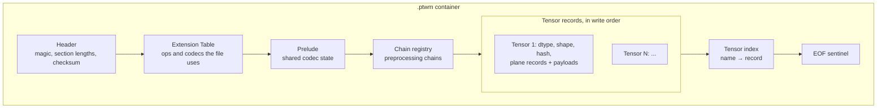

The `.ptwm` file is a multi-tensor container. A single file holds many
tensors with a shared Extension Table, a chain registry, a tensor
index, and per-plane codec dispatch.

PTWM writes the container in one of two layouts:

| Layout | Magic | Default | Readers |
|---|---|---|---|
| Compact (PTWC) | `\x89PTWC\r\n\x1a\n` | yes, since v1.2 | v1.2 and later |
| Legacy (PTWM) | `\x89PTWM\r\n\x1a\n` | no | v1.2 and later; v1.1 with a caveat |

Both hold the same content and decode the same way. The compact layout
stores built-in codecs and operations by wire id, uses varints, and
keeps tensor names in the index. For 64 small fp32 tensors it costs
about 83 bytes per tensor besides the coded data, against 235 bytes for
the legacy layout. Choose the legacy layout only for readers older than
v1.2 (see [Compatibility](#compatibility)).

Single-tensor output from `Compressor.compress` uses a third, smaller
format by default, the compact frame (`\x89PTWS`). See
[Single-tensor frame](#single-tensor-frame).

## Layout



Each tensor record holds its chain reference, dtype, shape and payload
hash, then one plane record per output of the chain. A plane record
names the codec of the plane, its codec state, an optional CRC32 and
chunk table, and is followed by the plane's payload bytes.

The byte-level layout of both layouts, and of the single-tensor frame,
is in [`docs/architecture/wire-format.md`](https://github.com/khwstolle/ptwm/blob/master/docs/architecture/wire-format.md).

## Random access

The tensor index maps each name to its record. Opening a `.ptwm` and
fetching one tensor touches only:

1. The header, Extension Table, prelude, chain registry and index. For
   a built-in-only file of 64 tensors these take about 2 KB in the
   compact layout, most of it the names in the index.
2. The record of that tensor: about 50 bytes for an fp32 tensor in the
   compact layout, 190 bytes in the legacy layout, plus its payloads.

Use [`TensorIndex`](/guides/random-access) to do this from Python. It
opens either layout and lists tensors in write order.

## Hash verification

Each tensor record can carry an xxh64 of the raw tensor bytes
(`emit_payload_hash`, 8 bytes per tensor), and each plane record a
CRC32 of the decoded plane (`emit_plane_crc`, 4 bytes per plane). The
decoder checks both before it returns bytes to the caller. A mismatch
raises `ptwm.Error`.

## Single-tensor frame

`Compressor.compress` writes a compact frame (`\x89PTWS`) by default:
one tensor with only the fields its decoder needs, at a fixed cost of
about 20 to 70 bytes. A tensor that needs shared codec state or chunked
planes falls back to a full container in the configured layout.
`Framing.CONTAINER` always writes a full container, which the
random-access, store and transcode tools need.

## Compatibility

Readers before v1.2 reject the compact container and the compact frame
with a "not a .ptwm container" or "bad magic" error; they do not
misread them. To write files that v1.1 opens, select the legacy layout
and the full container:

```python
from ptwm import CompressionConfig, ContainerLayout, Framing

config = CompressionConfig(
    framing=Framing.CONTAINER,
    container_layout=ContainerLayout.LEGACY,
)
```

The multi-tensor writers (`compress_ptwm_blob`, `write_ptwm_shard`,
`compress_safetensors_file`, the LMDB and WebDataset writers) take
`container_layout="legacy"`, and the CLI takes
`ptwm compress --container-layout legacy` for every output, including
the per-tensor `.ptwm.safetensors` file. Legacy writers record the
built-in ids of version 1.1.0, which v1.1 readers recognise; see the
[release notes](/release-notes) for the details.

## Modes for safetensors input

The `compress_safetensors_file` entry point writes the compressed payload
in one of two shapes; the `mode` argument selects which:

| Mode           | Output                                              | Use when                                                                            |
| -------------- | --------------------------------------------------- | ----------------------------------------------------------------------------------- |
| `"a"` (native) | A `.ptwm` directory with one `.ptwm` blob per shard | You control the loader and want the cleanest random-access surface.                 |
| `"b"` (shell)  | A `.safetensors` shell wrapping a `.ptwm` blob      | You need the result to look like a regular `.safetensors` file to existing tooling. |

Both modes round-trip through PTWM and both take `container_layout`.
Mode `a` is the default.
